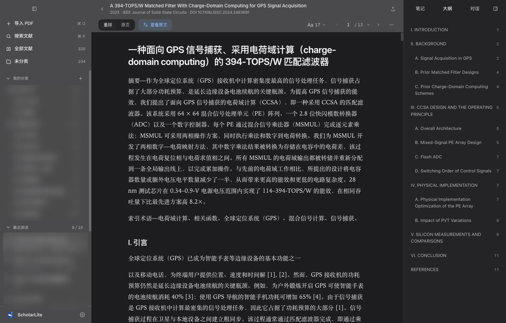
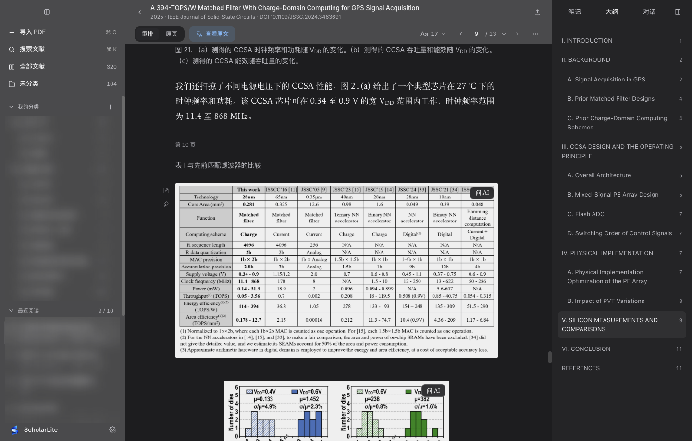
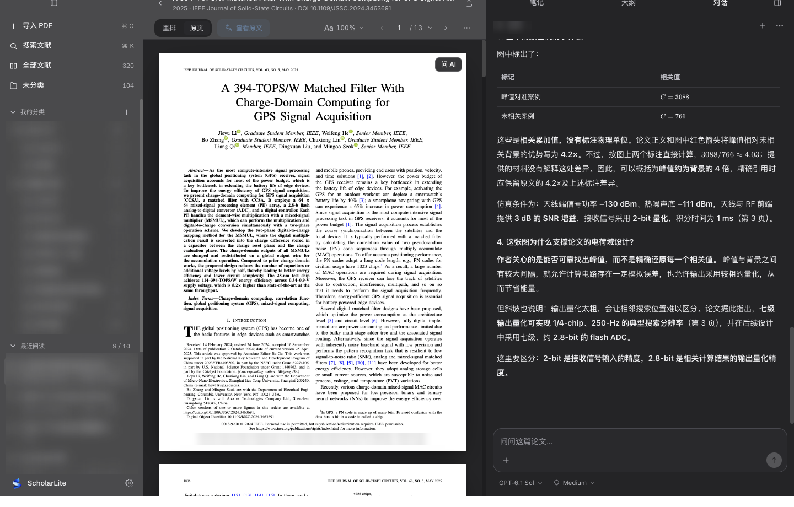
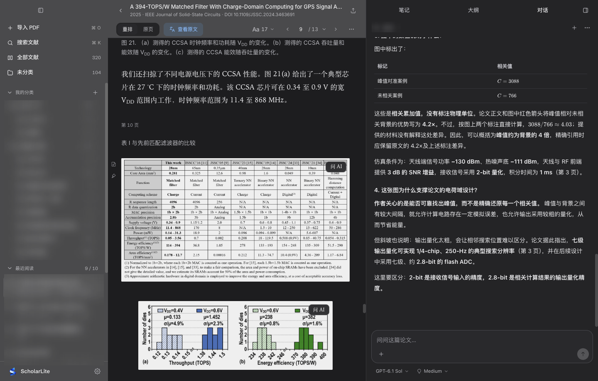
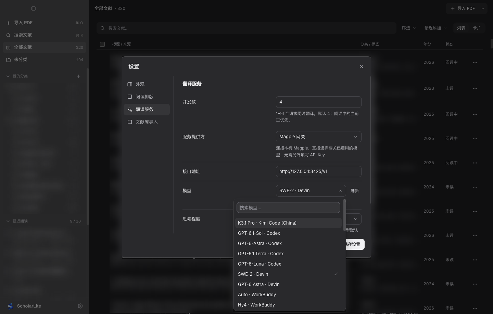
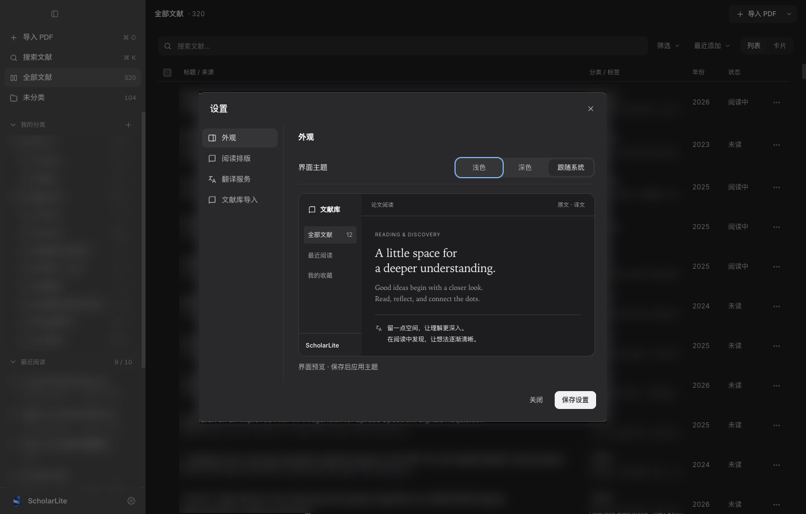
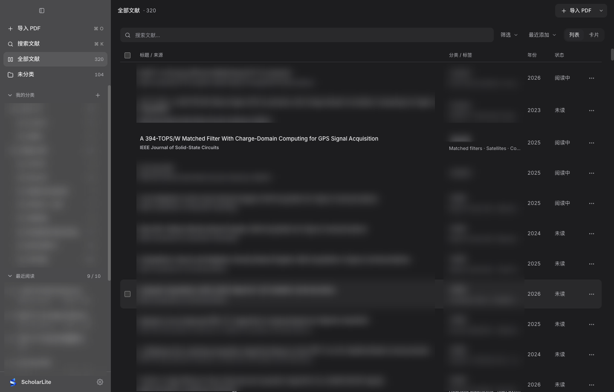
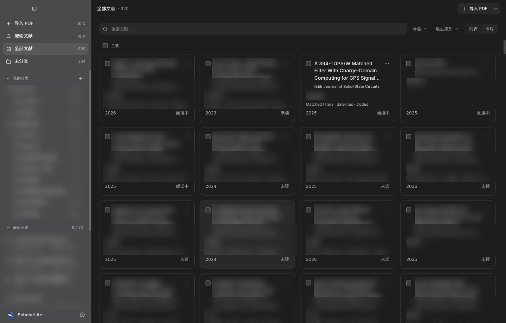

<div align="center">


# ScholarLite

**把双栏 PDF 变成顺滑的单栏网页，直接调用本机 Codex / Claude Code 陪你精读顶刊论文。**

[](#快速开始)
[](#架构与工程测试)
[](#多级课题书库与-zotero-无损迁移)
[](#零配置接入本机-agent-的论文对话)
[](./LICENSE)

[**核心亮点**](#核心亮点) · [**论文重排**](#1-懂学术版面的-pdf-重排引擎告别双栏滚屏) · [**AI 对话与读图**](#2-零配置接入本机-agent-的论文对话) · [**流式学术翻译**](#3-数学公式零破坏的流式中文翻译) · [**课题书库**](#4-多级课题书库与-zotero-无损迁移) · [**快速开始**](#快速开始)

</div>

<br />

<p align="center">
  
</p>

---

## 核心亮点

- **📖 告别双栏上下滚屏**：自动剥离页眉页脚与双栏束缚，将 IEEE / ACM / Nature / arXiv 论文重排为响应式单栏排版；矢量图、三线表与行内公式原汁原味保留，一键切回原版双栏 PDF 核对页码。
- **🤖 零 API Key 接入本机 Agent**：自动探测并复用本机已登录的 **Codex CLI** 与 **Claude Code CLI**，无需额外配置密钥即可针对当前页面、框选图表或高亮段落深度追问，支持 **OpenUI** 交互式图表与公式滑块推演。
- **🌐 数学公式零破坏的流式翻译**：专为理工科论文打磨的占位符保护管线，数学符号、上下标、希腊字母与交叉引用 `[1]` 100% 原样保留；支持 **Magpie 网关**、**OpenAI 兼容接口**、**DeepSeek**、**Ollama**、**DeepL** 与 **Google 翻译**，译文落盘 SQLite 秒开不重翻。
- **🗂️ 本地优先的百篇级课题书库**：全部文献、多级课题目录、彩色高亮批注与对话历史均存储在本地 SQLite 数据库，支持 **Zotero 一键无损迁移** 与 DOI / arXiv 元数据自动补全。

---

## 1. 懂学术版面的 PDF 重排引擎（告别双栏滚屏）

传统 PDF 阅读器在笔记本屏幕上读双栏顶刊时，视线必须高频上下折返。ScholarLite 内置多策略版面分析管线，精准识别标题、作者、摘要、章节层级、跨栏大图、算法伪代码与复杂三线表：

- **宽表与矢量图完整呈现**：自动侦测跨栏三线表（如 `TABLE I` 性能对比表）与高分辨率电路/架构图，自适应铺满阅读视口，绝不截断列宽。
- **重排 / 原页 1 秒无感切换**：顶部工具栏随时在「重排」（沉浸单栏）与「原页」（双栏高保真 PDF）之间切换，并保持当前阅读页码同步。

<table>
  <tr>
    <td width="50%" align="center">
      
      <sub><b>单栏重排模式</b> · 跨栏三线表完整展开，悬停插图即刻唤出右上角「问 AI」</sub>
    </td>
    <td width="50%" align="center">
      
      <sub><b>原页双栏模式</b> · 1:1 还原期刊原始双栏排版，随时核对原图与公式编号</sub>
    </td>
  </tr>
</table>

---

## 2. 零配置接入本机 Agent 的「论文对话」

不需要在阅读器里重复填写付费 API Key——只要你的 Mac 上装有 **Codex** 或 **Claude Code**，打开右侧「**对话**」面板即可直接调用旗舰推理模型陪读：

- **插图与表格一键裁切追问**：鼠标悬停在任意芯片架构图、实验曲线或三线表上，点击图片右上角内嵌的「**问 AI**」胶囊，或在原页模式下按住拖选任意区域，自动以高分辨率截图附带上下文送入对话。
- **高亮段落即选即问**：在正文选中任意难懂段落，右键或点击浮动工具条「**引用到对话**」，直接围绕该段推导细节展开问答。
- **OpenUI 交互式可视化**：当询问参数权衡或电路/算法灵敏度时，AI 可直接在侧栏生成可拖拽参数的交互式图表与对比卡片。

<p align="center">
  
</p>

---

## 3. 数学公式零破坏的流式中文翻译

通用网页翻译插件经常把论文里的变量符号、上下标和缩写词改得面目全非。ScholarLite 采用专为理工科论文设计的 **「公式掩码 → 上下文并发流式翻译 → 术语与连字符清洗 → 本地 SQLite 缓存」** 管线：

- **三种阅读对照视图**：工具栏一键切换「**原文**」、「**译文**」（纯中文沉浸精读）与「**双语**」（段落级中英对照）。
- **公式与专业缩写精确锁死**：`SAR ADC`、`Monte Carlo`、`SNDR` 等短术语与行内/独立公式块严密保护，复合连字符（如 `closed-loop`、`weak-inversion`）智能留存，绝不吐出乱码占位符。
- **全通道翻译引擎支持**：内置模型搜索下拉框与连通性一键测试，兼顾零成本体验与企业/实验室私有网关。

<table>
  <tr>
    <td width="50%" align="center">
      
      <sub><b>多引擎翻译配置</b> · 内置模型搜索下拉框、并发调优与一键连通性测试</sub>
    </td>
    <td width="50%" align="center">
      
      <sub><b>纸墨阅读主题</b> · 提供浅色、护眼暖纸、深色与跟随系统四种视觉材质</sub>
    </td>
  </tr>
</table>

| 翻译引擎 | 适用场景 | 鉴权与接入方式 |
| :--- | :--- | :--- |
| **Magpie 网关** | 实验室 / 团队统一大模型网关 | 支持读取本机 `~/.magpie/` CLI 登录态，或填入 API 地址与密钥 |
| **OpenAI 兼容接口** | OneAPI / NewAPI / OpenRouter / 硅基流动 / 智谱 | 自定义 `Base URL`（自动兼容 `/v1` 与 `/v4` 根路径）+ API Key |
| **DeepSeek** | 高性价比中文学术精翻 | 官方 API Key（默认 `deepseek-chat`） |
| **Ollama 本地模型** | 100% 离线私密翻译 | 本机 `http://127.0.0.1:11434`，无需联网与 Key |
| **DeepL / Google 翻译** | 开箱即用快速浏览 | Google 翻译零配置直连；DeepL 支持 Free / Pro API Key |

---

## 4. 多级课题书库与 Zotero 无损迁移

专为动辄数百篇文献的博士生与芯片/AI 研究员打造，拒绝平铺直叙的杂乱文件夹：

- **无限层级课题目录树**：左侧边栏支持按研究方向、流片项目或顶会年份建立多级子目录，拖拽即可归档文献。
- **列表 / 卡片双视图切换**：紧凑「列表视图」直观展示期刊/会议徽章（`JSSC`、`ISSCC`、`TCAD`）、年份与阅读进度；「卡片视图」提供沉浸式封面墙。
- **Zotero 一键导入与智能元数据检索**：直接读取本机 `~/Zotero/zotero.sqlite` 同步分类树与 PDF 附件；拖入散装 PDF 自动提取标题并联网补全作者、会议与年份。

<table>
  <tr>
    <td width="50%" align="center">
      
      <sub><b>紧凑列表视图</b> · 300+ 篇文献丝滑检索，期刊徽章、年份与阅读进度一目了然</sub>
    </td>
    <td width="50%" align="center">
      
      <sub><b>网格卡片视图</b> · 清晰的论文标题排版与多维排序筛选</sub>
    </td>
  </tr>
</table>

---

## 快速开始

### 环境要求

- **操作系统**：macOS 13.0+（Apple Silicon / Intel）
- **运行环境**：Node.js `20+`、npm `10+`
- **可选组件**：
  - 安装 [Codex CLI](https://github.com/openai/codex) 或 [Claude Code](https://docs.anthropic.com/en/docs/agents-and-tools/claude-code/overview) 以启用零配置 AI 论文对话
  - 安装 Python 3 + `pix2tex` / `rapid_latex_ocr` 以启用复杂栅格公式离线 LaTeX OCR

### 安装与启动

```bash
# 1. 克隆仓库并安装依赖（会自动为当前 Electron 编译原生 SQLite 驱动）
git clone https://github.com/Max-G01/scholaread-lite.git
cd scholaread-lite
npm install

# 2. 构建并启动桌面应用
npm start

# 或者启动热重载开发模式
npm run dev
```

> 💡 **可选：一键配置离线公式 LaTeX OCR 环境**
> ```bash
> sh scripts/setup-formula-ocr.sh
> ```

### 常用快捷键

| 快捷键 | 功能说明 |
| :--- | :--- |
| `⌘ + F` | 在书库中聚焦全局搜索，或在阅读器内打开全文检索栏 |
| `⌘ + K` | 快速唤出右侧「**对话**」面板并聚焦提问输入框 |
| `←` / `→` | 在阅读器内快速翻至上一页 / 下一页 |
| `⌘ + +` / `⌘ + -` | 在原页 PDF 模式下放大 / 缩小页面比例 |
| `Esc` | 关闭当前弹窗、预览大图或取消全文检索高亮 |

---

## 架构与工程测试

<details>
<summary><b>📦 展开查看项目目录结构与本地数据存储路径</b></summary>

<br />

```text
scholaread-lite/
├── assets/                          # 应用图标与 README 实机高清截图
├── scripts/
│   ├── formula_ocr_worker.py        # 离线数学公式 LaTeX OCR 常驻 Worker
│   ├── inspect-reflow.ts            # 重排管线命令行诊断工具
│   └── setup-formula-ocr.sh         # 公式 OCR Python 虚拟环境一键安装脚本
├── src/
│   ├── main/                        # Electron 主进程
│   │   ├── index.ts                 # 窗口生命周期、安全策略与系统集成
│   │   ├── ipc.ts                   # 全量 IPC 路由与本地任务编排
│   │   ├── db.ts                    # SQLite 存储层（文献、多级目录、批注、译文缓存）
│   │   ├── reflow.ts                # 多策略重排调度、栅格插图裁切与结构恢复
│   │   ├── translation.ts           # 公式掩码保护、并发分块流式翻译与术语清洗
│   │   ├── agent-service.ts         # Codex / Claude Code CLI 自动探测与会话流管理
│   │   ├── zotero.ts                # Zotero 本地数据库无损导入器
│   │   └── metadata.ts              # Crossref / arXiv 元数据自动补全服务
│   ├── preload/
│   │   └── index.ts                 # contextBridge 安全隔离 API 注入
│   ├── renderer/                    # React 19 + Vite 前端视图层
│   │   ├── components/
│   │   │   ├── LibraryView.tsx      # 文献书库（列表/卡片视图、多级目录树）
│   │   │   ├── ReaderView.tsx       # 阅读器核心（重排/原页切换、全文检索、图文框选）
│   │   │   ├── AgentPanel.tsx       # 右侧 AI 对话面板与 OpenUI 交互卡片渲染
│   │   │   └── SettingsModal.tsx    # 外观、阅读排版、翻译引擎与导入设置弹窗
│   │   └── styles.css               # 原生 macOS 纸墨质感样式系统
│   └── shared/                      # 主进程与渲染进程共享的核心算法
│       ├── text-reflow.ts           # PDF 文本流聚合、章节推断与散碎数学行合并
│       ├── text-reflow-table.ts     # 跨栏三线表检测与自适应布局重建
│       └── latex-normalizer.ts      # 数学符号归一化与公式渲染保护
└── tests/                           # 38 项自动化回归与真实顶刊 PDF 语料验收套件
```

**本地数据存储路径（macOS）**：
- **SQLite 数据库**：`~/Library/Application Support/ScholarLite/scholarlite.db`
- **托管 PDF 文献库**：`~/Library/Application Support/ScholarLite/papers/`
- **重排插图与翻译缓存**：`~/Library/Application Support/ScholarLite/cache/`

</details>

<details>
<summary><b>🧪 展开查看自动化回归与真实语料验收命令（38 项测试套件）</b></summary>

<br />

ScholarLite 配备覆盖版面重排、跨栏表格恢复、公式保护翻译与真实 PDF 语料的完整测试套件：

```bash
# 运行核心单元测试与模块回归测试（12 大测试套件 / 38 项断言）
npm test

# 在真实顶刊 PDF 语料上运行重排质量门禁与跨页审计
npm run test:corpus
npm run test:audit
npm run test:fidelity

# 针对单篇 PDF 输出重排分块与版面诊断报告
npm run inspect:reflow -- "/path/to/paper.pdf"
```

</details>

---

## 隐私安全与开源许可

- **Local-First 隐私承诺**：你的所有 PDF 原件、高亮笔记、课题分类与翻译缓存均 100% 存储在本地硬盘中，ScholarLite 不包含任何遥测上报或云端账号绑定。
- **渲染进程严格沙箱化**：遵循 Electron 安全最佳实践，开启 `contextIsolation: true`、`sandbox: true` 且禁用 `nodeIntegration`，所有外部链接均通过安全白名单交由系统默认浏览器打开。
- **开源协议**：本项目基于 [MIT License](./LICENSE) 开源。
