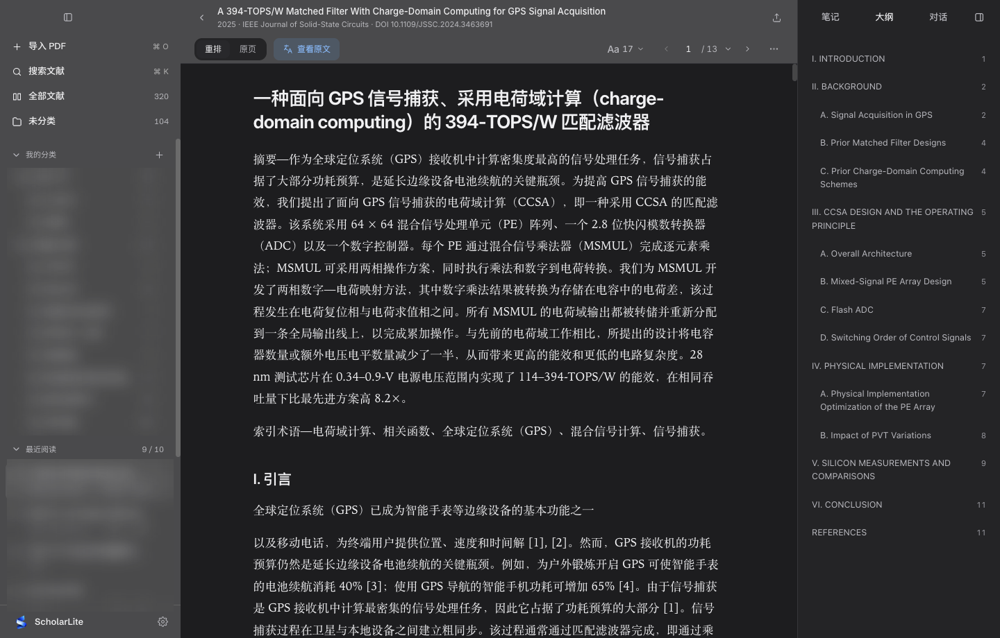
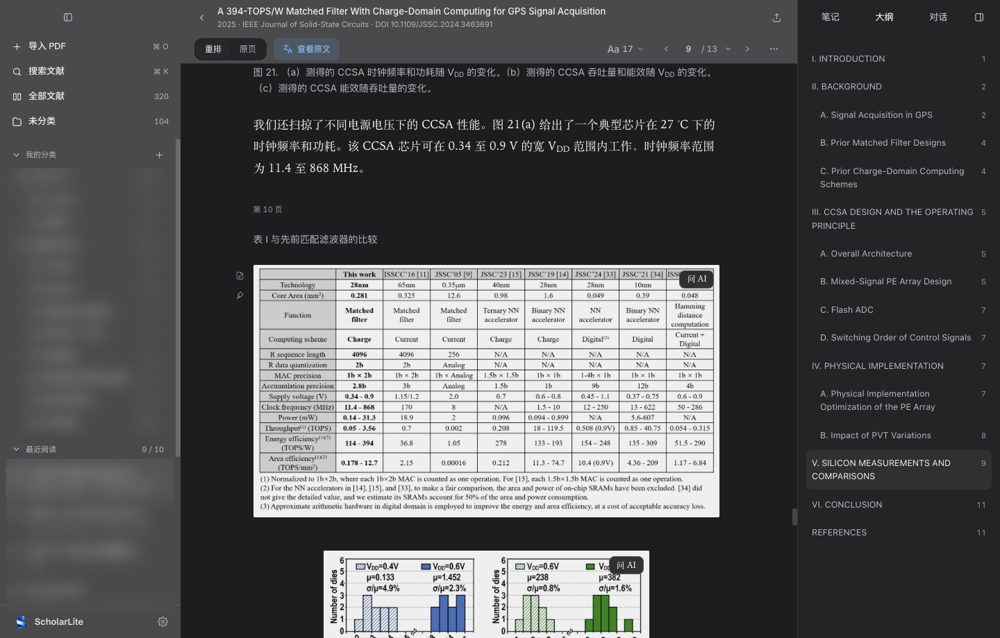
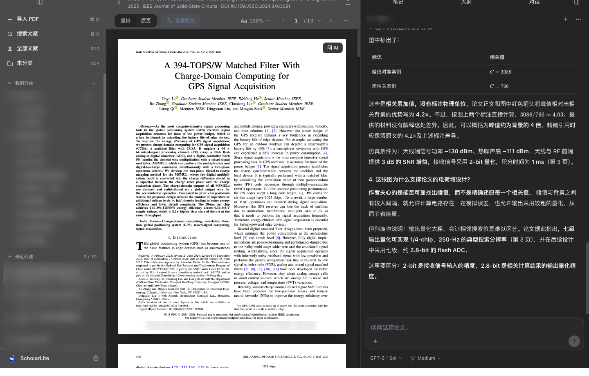
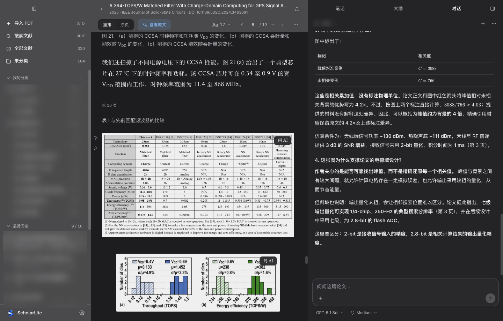
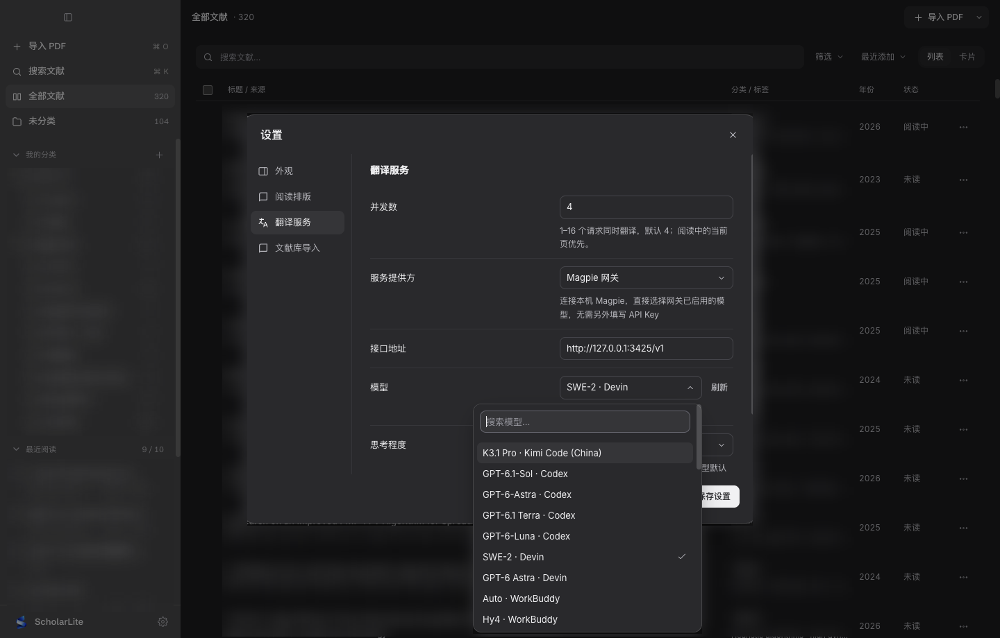
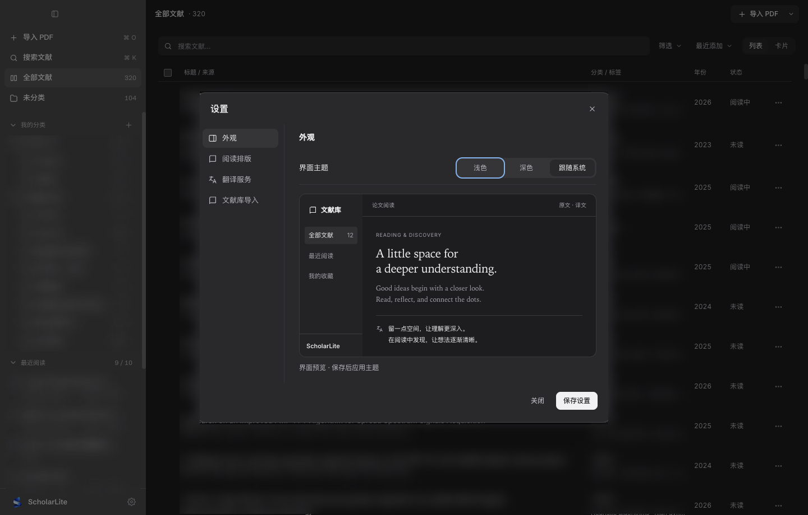
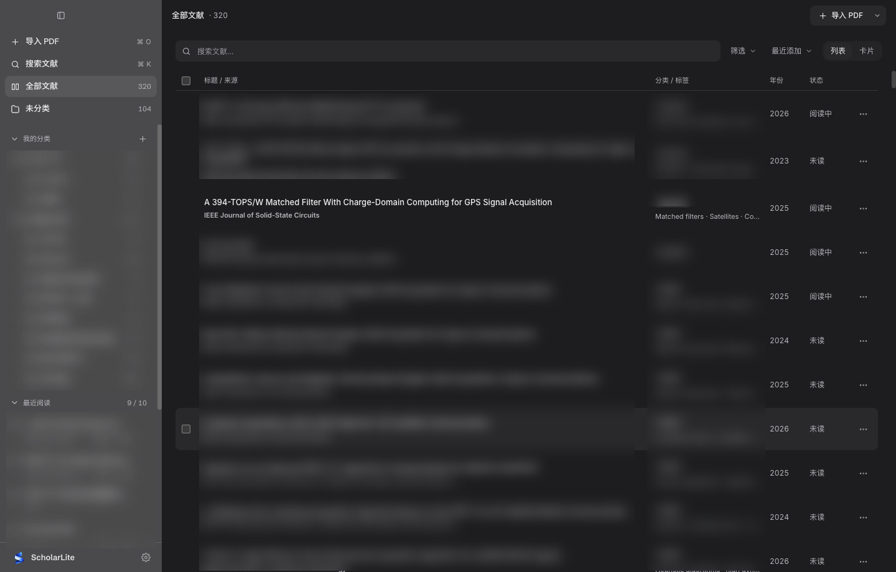
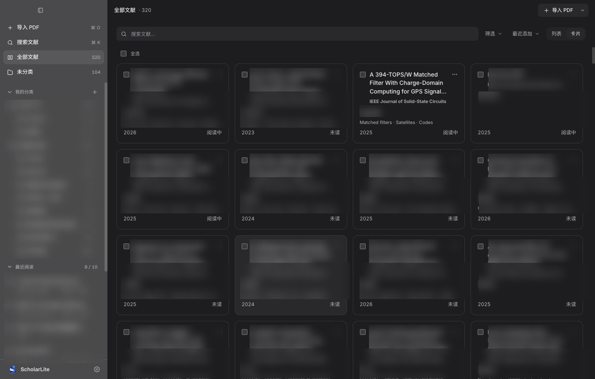

<div align="center">


# ScholarLite

**把双栏 PDF 变成顺滑的单栏网页，直接调用本机 Codex / Claude Code 陪你精读顶刊论文。**

[](#快速开始)
[](#架构与工程测试)
[](#多级课题书库与-zotero-无损迁移)
[](#零配置接入本机-agent-的论文对话)
[](./LICENSE)

[**核心亮点**](#核心亮点) · [**论文重排**](#1-懂学术版面的-pdf-重排引擎告别双栏滚屏) · [**AI 对话与读图**](#2-零配置接入本机-agent-的论文对话) · [**流式学术翻译**](#3-数学公式零破坏的流式中文翻译) · [**课题书库**](#4-多级课题书库与-zotero-无损迁移) · [**快速开始**](#快速开始)

</div>

<br />

<p align="center">
  
</p>

---

## 核心亮点

- **📖 告别双栏上下滚屏**：自动剥离页眉页脚与双栏束缚，将 IEEE / ACM / Nature / arXiv 论文重排为响应式单栏排版；矢量图、三线表与行内公式原汁原味保留，一键切回原版双栏 PDF 核对页码。
- **🤖 零 API Key 接入本机 Agent**：自动探测并复用本机已登录的 **Codex CLI** 与 **Claude Code CLI**，无需额外配置密钥即可针对当前页面、框选图表或高亮段落深度追问，支持 **OpenUI** 交互式图表与公式滑块推演。
- **🌐 数学公式零破坏的流式翻译**：专为理工科论文打磨的占位符保护管线，数学符号、上下标、希腊字母与交叉引用 `[1]` 100% 原样保留；支持 **Magpie 网关**、**OpenAI 兼容接口**、**DeepSeek**、**Ollama**、**DeepL** 与 **Google 翻译**，译文落盘 SQLite 秒开不重翻。
- **🗂️ 本地优先的百篇级课题书库**：全部文献、多级课题目录、彩色高亮批注与对话历史均存储在本地 SQLite 数据库，支持 **Zotero 一键无损迁移** 与 DOI / arXiv 元数据自动补全。

---

## 1. 懂学术版面的 PDF 重排引擎（告别双栏滚屏）

传统 PDF 阅读器在笔记本屏幕上读双栏顶刊时，视线必须高频上下折返。ScholarLite 内置多策略版面分析管线，精准识别标题、作者、摘要、章节层级、跨栏大图、算法伪代码与复杂三线表：

- **宽表与矢量图完整呈现**：自动侦测跨栏三线表（如 `TABLE I` 性能对比表）与高分辨率电路/架构图，自适应铺满阅读视口，绝不截断列宽。
- **重排 / 原页 1 秒无感切换**：顶部工具栏随时在「重排」（沉浸单栏）与「原页」（双栏高保真 PDF）之间切换，并保持当前阅读页码同步。

<table>
  <tr>
    <td width="50%" align="center">
      
      <sub><b>单栏重排模式</b> · 跨栏三线表完整展开，悬停插图即刻唤出右上角「问 AI」</sub>
    </td>
    <td width="50%" align="center">
      
      <sub><b>原页双栏模式</b> · 1:1 还原期刊原始双栏排版，随时核对原图与公式编号</sub>
    </td>
  </tr>
</table>

---

## 2. 零配置接入本机 Agent 的「论文对话」

不需要在阅读器里重复填写付费 API Key——只要你的 Mac 上装有 **Codex** 或 **Claude Code**，打开右侧「**对话**」面板即可直接调用旗舰推理模型陪读：

- **插图与表格一键裁切追问**：鼠标悬停在任意芯片架构图、实验曲线或三线表上，点击图片右上角内嵌的「**问 AI**」胶囊，或在原页模式下按住拖选任意区域，自动以高分辨率截图附带上下文送入对话。
- **高亮段落即选即问**：在正文选中任意难懂段落，右键或点击浮动工具条「**引用到对话**」，直接围绕该段推导细节展开问答。
- **OpenUI 交互式可视化**：当询问参数权衡或电路/算法灵敏度时，AI 可直接在侧栏生成可拖拽参数的交互式图表与对比卡片。

<p align="center">
  
</p>

---

## 3. 数学公式零破坏的流式中文翻译

通用网页翻译插件经常把论文里的变量符号、上下标和缩写词改得面目全非。ScholarLite 采用专为理工科论文设计的 **「公式掩码 → 上下文并发流式翻译 → 术语与连字符清洗 → 本地 SQLite 缓存」** 管线：

- **原位中文沉浸切换**：重排模式下工具栏一键切换「**查看译文**」与「**查看原文**」，标题、正文、图注、表注与参考文献并发流式原位替换为中文，图表原稿裁片与行间公式保留原位；支持正文划词即时翻译。
- **二维数学与学术连字符保真**：内联变量、科学上下标（`<sub>`/`<sup>`）与连续二维数学空间组全程编码保护并往返校验；行尾断词采用「同文档词频自洽 + 现代英文词典」判定，消除 `accu-rate` 等残留断词并保留 `time-series`、`closed-loop` 等真实复合词。
- **多通道翻译与协议自动探测**：内置模型搜索下拉框与参数兼容降级恢复，兼顾企业/实验室私有网关与本地离线部署。

<table>
  <tr>
    <td width="50%" align="center">
      
      <sub><b>多引擎翻译配置</b> · 内置模型搜索下拉框、并发调优与一键连通性测试</sub>
    </td>
    <td width="50%" align="center">
      
      <sub><b>纸墨阅读主题</b> · 提供浅色、深色与跟随系统三种外观模式，支持衬线/无衬线与字号行距实时预览</sub>
    </td>
  </tr>
</table>

| 翻译引擎 | 适用场景 | 鉴权与接入方式 |
| :--- | :--- | :--- |
| **Magpie 网关** | 实验室 / 团队统一大模型网关 | 连接网关地址（默认 `http://127.0.0.1:3425/v1`），免填上游密钥自动拉取模型与思考档位 |
| **OpenAI 兼容接口** | OneAPI / NewAPI / OpenRouter / 硅基流动 / 智谱 | 自定义 `Base URL`（自动探测 `/v1`、兼容 `/v4` 等路径并剥离冗余后缀）+ API Key |
| **DeepSeek** | 高性价比中文学术精翻 | 官方 API Key（默认 `https://api.deepseek.com/v1`），支持自动拉取模型列表 |
| **Ollama 本地模型** | 100% 离线私密翻译 | 本机 `http://127.0.0.1:11434`，自动读取已安装模型，无需联网与 Key |
| **DeepL / Google 翻译** | 传统机器翻译接口 | 支持 DeepL Free / Pro 接口地址与 Google Cloud Translation v2 API Key |

---

## 4. 多级课题书库与 Zotero 无损迁移

专为动辄数百篇文献的博士生与芯片/AI 研究员打造，拒绝平铺直叙的杂乱文件夹：

- **无限层级课题目录树**：左侧边栏支持按研究方向、流片项目或顶会年份建立多级子目录，拖拽即可归档文献。
- **列表 / 卡片双视图切换**：紧凑「列表视图」直观展示期刊/会议徽章（`JSSC`、`ISSCC`、`TCAD`）、年份与阅读进度；「卡片视图」提供沉浸式封面墙。
- **Zotero 一键导入与智能元数据检索**：直接读取本机 `~/Zotero/zotero.sqlite` 同步分类树与 PDF 附件；拖入散装 PDF 自动提取标题并联网补全作者、会议与年份。

<table>
  <tr>
    <td width="50%" align="center">
      
      <sub><b>紧凑列表视图</b> · 300+ 篇文献丝滑检索，期刊徽章、年份与阅读进度一目了然</sub>
    </td>
    <td width="50%" align="center">
      
      <sub><b>网格卡片视图</b> · 清晰的论文标题排版与多维排序筛选</sub>
    </td>
  </tr>
</table>

---

## 快速开始

### 环境要求

- **操作系统**：macOS 13.0+（Apple Silicon / Intel）
- **运行环境**：Node.js `20+`、npm `10+`
- **可选组件**：
  - 安装 [Codex CLI](https://github.com/openai/codex) 或 [Claude Code](https://docs.anthropic.com/en/docs/agents-and-tools/claude-code/overview) 以启用零配置 AI 论文对话
  - 安装 Python 3 + `pix2tex` / `rapid_latex_ocr` 以启用复杂栅格公式离线 LaTeX OCR

### 安装与启动

```bash
# 1. 克隆仓库并安装依赖（会自动为当前 Electron 编译原生 SQLite 驱动）
git clone https://github.com/guojunjie0614-cyber/scholaread-lite.git
cd scholaread-lite
npm install

# 2. 构建并启动桌面应用
npm start

# 或者启动热重载开发模式
npm run dev
```

> 💡 **可选：一键配置离线公式 LaTeX OCR 环境**
> ```bash
> sh scripts/setup-formula-ocr.sh
> ```

### 常用快捷键

| 快捷键 | 功能说明 |
| :--- | :--- |
| `⌘ + K` / `⌘ + F` | 返回文献书库并聚焦全库搜索框 |
| `⌘ + O` | 打开文件选择器导入本地 PDF 文献 |
| `⌘ + ,` | 打开「设置」弹窗（外观、阅读排版、翻译服务、文献库导入） |
| `⌘ + Enter` | 在笔记或公式编辑器中快速保存当前内容 |
| `Esc` | 关闭当前弹窗、下拉菜单或取消笔记编辑 |

---

## 架构与工程测试

<details>
<summary><b>📦 展开查看项目目录结构与本地数据存储路径</b></summary>

<br />

```text
scholaread-lite/
├── assets/                          # 应用图标与 README 实机截图
├── electron/                        # Electron 主进程与预加载层
│   ├── main.ts                      # 窗口生命周期、协议注册与会话安全策略
│   ├── preload.ts                   # contextBridge 安全隔离 IPC API 注入
│   ├── ipc.ts                       # 文献、分块、批注、配置与元数据 IPC 路由
│   ├── db.ts                        # Node SQLite 存储层（文献、多级分类、批注、译文缓存）
│   ├── translate.ts                 # 优先级并发流式翻译调度、缓存自愈与错误隔离
│   ├── magpie.ts                    # 模型目录拉取、端点规范化与 /v1 契约探测
│   ├── http.ts                      # Electron net.fetch 与 macOS 系统代理适配
│   ├── library-import.ts            # Zotero 数据库（含 WAL）只读导入与目录扫描
│   ├── metadata.ts                  # Crossref / arXiv 元数据补全服务
│   └── chat/                        # Codex App Server / Claude Code CLI 对话适配与存储
├── renderer/src/                    # React 19 + Vite 前端视图与重排引擎
│   ├── App.tsx                      # 顶层状态、书库/阅读切换与全局快捷键
│   ├── components/                  # 书库（LibraryHome）、阅读器（Reader）、设置、笔记与对话面板
│   ├── chat/visuals/                # OpenUI 1.0 交互式图表与示意组件库
│   └── reflow/                      # 学术 PDF 重排核心（版面分栏、连通域、三线表、行内数学、OCR）
├── shared/                          # 主进程与渲染进程共享契约与纯算法
│   ├── types.ts                     # 全局数据结构与 IPC 类型定义
│   ├── english-lexicon.ts           # 文档词频自洽 + 紧凑现代英文词典断词消解
│   ├── translation-scripts.ts       # 二维数学占位符保护、上下标校验与复读前缀对齐剥离
│   └── venue.ts                     # 期刊/会议标准简称归一化
├── scripts/                         # 构建、打包、原生 Vision OCR、公式 OCR 与测试运行脚本
└── tests/                           # 自动化单元/集成回归与真实论文语料验收套件
```

**本地数据存储路径（macOS）**：
- **SQLite 数据库**：`~/Library/Application Support/ScholarLite/library.db`（含文献、分类树、重排块、高亮批注、译文缓存与对话记录）
- **托管 PDF 文献库**：`~/Library/Application Support/ScholarLite/library/`
- **用户配置文件**：`~/Library/Application Support/ScholarLite/config.json`

</details>

<details>
<summary><b>🧪 展开查看类型检查、自动化回归与真实语料验收命令</b></summary>

<br />

ScholarLite 配备覆盖版面重排、三线表与公式结构恢复、数学保护流式翻译、Zotero 迁移与真实论文语料的测试套件：

```bash
# 运行 TypeScript 全量严格类型检查
npm run typecheck

# 运行全部自包含单元与集成回归测试套件
npm test

# 在真实论文语料集（dev / holdout / regression）上运行重排验收门禁
npm run test:corpus

# 针对单篇本地 PDF 输出重排分块诊断结果
npm run inspect:reflow -- "/path/to/paper.pdf"
```
</details>

---

## 隐私安全与开源许可

- **Local-First 隐私承诺**：你的所有 PDF 原件、高亮笔记、课题分类与翻译缓存均 100% 存储在本地硬盘中，ScholarLite 不包含任何遥测上报或云端账号绑定。
- **渲染进程严格沙箱化**：遵循 Electron 安全最佳实践，开启 `contextIsolation: true`、`sandbox: true` 且禁用 `nodeIntegration`，所有外部链接均通过安全白名单交由系统默认浏览器打开。
- **开源协议**：本项目基于 [MIT License](./LICENSE) 开源。
